# About Me
CSED student @ Alexandria University. I enjoy building things — low-level tools, systems software, and the occasional AI experiment.

## Socials

## Tech Stack

## Preferences

## GitHub Stats

## Competitive Programming
- LeetCode: approx. 145 problems — 83 medium, 17 hard
- Codeforces: approx. 250 problems 
